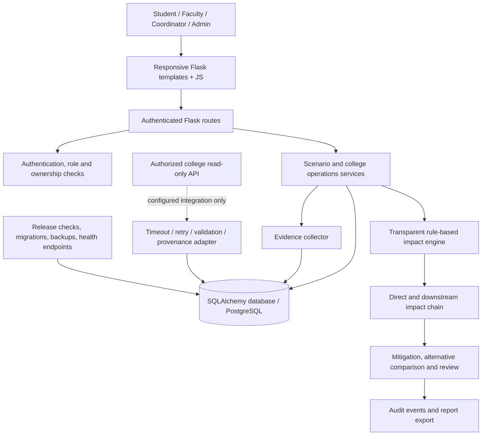

# CampusRipple architecture (implemented boundaries)

## Trust boundaries

- Public registration cannot grant elevated roles; administrator provisioning is an operator action.
- Scenario access is restricted by ownership, with explicitly permitted coordinator/admin access where the route allows it.
- External API payloads are untrusted input and must pass validation before storage.
- Rule-based hypotheses are not official college facts. Only explicitly sourced application records count as record-backed evidence.
- Production secrets, real SMTP, HTTPS, live ERP/SIS credentials, restore drills, and performance evidence are deployment responsibilities, not bundled sample values.
